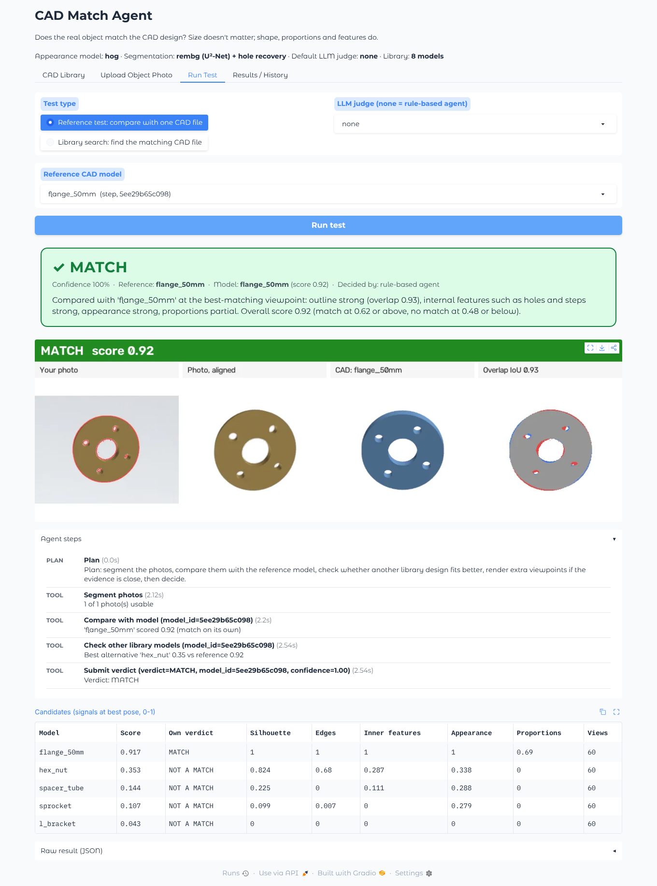
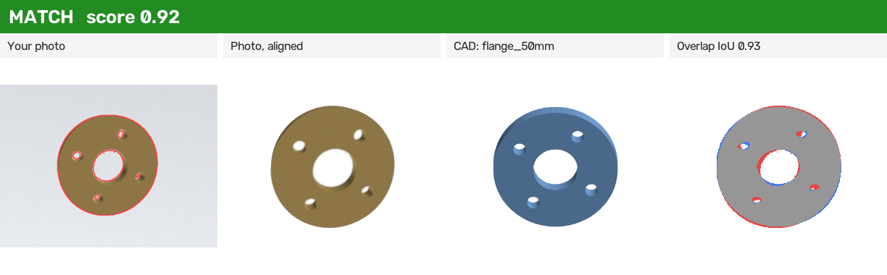
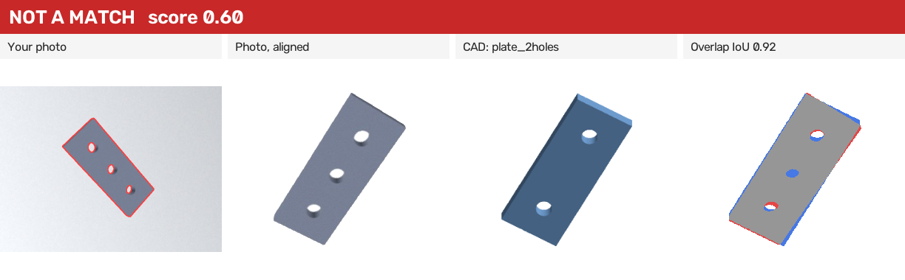
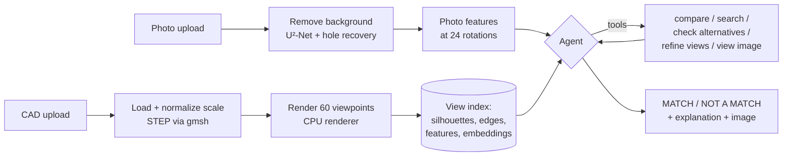

# CAD Match Agent

An AI agent that checks whether a **real object in a photo matches the design of a CAD model**,
regardless of size. Upload a library of CAD files (STL, OBJ, PLY, STEP), upload a photo of a part,
and the agent tells you **MATCH** or **NOT A MATCH**, shows you why, and logs every step it took.



## Highlights

- **Size never matters.** A 10× larger copy of a design is a MATCH; a same-size part with one extra hole is NOT A MATCH.
- **Two test modes.** *Reference test* checks the photo against one CAD file you pick. *Library search* finds which CAD file in the whole library matches.
- **A real agent.** It plans, calls tools (segment photo → compare → check other designs → render more viewpoints → inspect side-by-side image), and decides. If the evidence is close, it asks for another photo instead of guessing.
- **Optional vision-LLM judge:** Claude, OpenAI or a local model through Ollama. It works fully offline without one.
- **Runs on a laptop CPU.** It needs no GPU and no OpenGL, and works the same on Windows, macOS and Linux.
- **Web UI + REST API**, test history, Docker, 60 automated tests, and MIT license.

| Match (object is 10× the CAD size) | Not a match (3 holes vs 2) |
|---|---|
|  |  |

In the overlay panel, **red** marks parts of the photo that the CAD doesn't cover, **blue** marks parts of the CAD that the photo doesn't cover, and **gray** marks overlap. The blue dot on the right is the extra hole.

---

## Quick start

You need **Python 3.10–3.13**.

```bash
git clone https://github.com/<you>/cad-match-agent.git
cd cad-match-agent

python -m venv .venv
# Windows:  .venv\Scripts\activate
# macOS/Linux:
source .venv/bin/activate

pip install -r requirements.txt
# Linux only (for STEP files): sudo apt install libglu1-mesa

python -m app.main
```

Open **http://localhost:7860**. Then:

1. **CAD Library** tab → click **Add sample CAD files** (or upload your own).
2. **Upload Object Photo** tab → pick a sample photo (or upload yours) → **Check photos**.
3. **Run Test** tab → choose *Reference test* + a model, or *Library search* → **Run test**.

> The first photo analysis downloads the background-removal model (~170 MB, once).

### With Docker

```bash
docker compose up --build
```

Then open http://localhost:7860. The library, history and downloaded models persist in `./data`.

---

## How it works



**1. Removing size.** Every CAD model is centered and scaled to fit a unit sphere. Every silhouette,
from a photo or a render, is centered on its centroid and scaled to a fixed RMS radius. After that,
a 5 mm part and a 5 m part with the same design look identical.

**2. Rendering.** Each model is rendered from 60 viewpoints spread over the whole sphere at upload
time and cached, so searches stay fast. The renderer is pure NumPy + OpenCV with no GPU.

**3. Photo segmentation.** U²-Net (`rembg`) finds the object outline. Through-holes, which U²-Net
tends to fill in, are restored by detecting background-colored regions inside the outline. A
classical fallback (border color model + GrabCut) works with no download.

**4. Matching signals.** For every photo rotation × CAD viewpoint, the matcher computes:

| Signal | What it captures |
|---|---|
| Silhouette IoU | outline overlap at the best pose |
| Edges | chamfer distance between all edges |
| Inner edges | hole rims, steps, face boundaries: the **design features** |
| Appearance | HOG descriptor (or DINOv2 if installed) of the shaded object |
| Proportions | aspect ratio, solidity, visible hole count (a missing hole is penalized mildly, an extra hole strongly) |
| Hu moments | rotation/scale-invariant shape moments (low weight) |

The signals are normalized and combined with weights from `config.yaml` into one score from 0 to 1.

**5. The agent** works in a tool loop and logs every step:

- `analyze_photos` checks photo quality.
- `compare_with_model` / `search_library` scores the candidates.
- `check_alternatives` asks whether another library design fits clearly better than the reference. If it does, the object is that design → NOT A MATCH. This step resolves near-identical designs such as 2 vs 3 holes.
- `refine_views` renders 72 extra viewpoints when a score is near a threshold.
- `view_comparison` produces the side-by-side image, so a vision LLM can inspect holes and slots.
- `submit_verdict` or `request_more_photos` ends the test.

Without an LLM, a rule-based policy drives the same tools. With one, the LLM plans and decides, and
the numeric decision is given to it as evidence. If the LLM fails or never decides, the rules finish
the test, so a test always completes.

---

## Using the app

### CAD Library
Upload any number of `.stl .obj .ply .step .stp` files, one at a time or in bulk. Each one is
validated, normalized and rendered (about 2–3 s per model), then stored permanently with a
thumbnail. You can rename or delete models. Exact duplicate files are detected automatically.

### Photo tips (they matter most for accuracy)
- Use a **plain background that contrasts** with the part (a dark part on white paper, a metal part on a dark cloth).
- Make the object fill **roughly a third of the frame**, fully in view, with nothing else in the picture.
- Use soft, even light, and avoid strong reflections.
- **Add 2–3 photos from different angles.** Each photo is scored separately and the results are averaged, and a hole that one view misses another view shows.

Use **Check photos** to see exactly what the agent will analyze (red outline).

### Results
Each test shows:
- the verdict and confidence
- the best-matching model
- the side-by-side image
- a plain-English explanation
- the per-signal scores for the top candidates
- the full agent log

Every test is saved in **Results / History**.

---

## Optional: LLM judge

Copy `.env.example` to `.env` and set one provider:

```ini
CAD_MATCH_LLM_PROVIDER=anthropic        # or openai, ollama, none
ANTHROPIC_API_KEY=sk-ant-...
# OPENAI_API_KEY=sk-...
# OLLAMA_BASE_URL=http://localhost:11434   (needs a vision model with tool calling, e.g. qwen2.5vl)
```

Model names are set in `config.yaml` (`agent:` section) or with the `ANTHROPIC_MODEL`,
`OPENAI_MODEL` and `OLLAMA_MODEL` environment variables. You can also switch the judge per test in
the **Run Test** tab. If a key is missing, the agent says so in the log and uses the rule-based policy.

## Optional: DINOv2 appearance embeddings

```bash
pip install torch --index-url https://download.pytorch.org/whl/cpu
pip install -r requirements-ml.txt
python -m scripts.library_cli reindex     # rebuild the view index with DINOv2
python -m scripts.calibrate --extra 4     # re-tune thresholds for the new embeddings
```

---

## REST API

Interactive docs are at **http://localhost:7860/docs** while the server runs.

```bash
# add CAD files
curl -F files=@part.step -F files=@other.stl http://localhost:7860/api/library

# list the library
curl http://localhost:7860/api/library

# reference test
curl -F photos=@photo1.jpg -F photos=@photo2.jpg -F mode=reference -F reference_id=<id> \
     http://localhost:7860/api/test

# library search
curl -F photos=@photo.jpg -F mode=library_search http://localhost:7860/api/test

# history and the comparison image
curl http://localhost:7860/api/history
curl -o result.png http://localhost:7860/api/history/<test_id>/comparison.png
```

| Method | Path | Purpose |
|---|---|---|
| GET | `/api/health` | status, library size, active backends |
| GET / POST | `/api/library` | list / upload CAD files |
| GET / PATCH / DELETE | `/api/library/{id}` | get / rename / delete |
| GET | `/api/library/{id}/thumbnail`, `/file` | preview image, original file |
| POST | `/api/test` | run a test (`photos[]`, `mode`, `reference_id`, `provider`) |
| GET | `/api/history`, `/api/history/{id}`, `/api/history/{id}/comparison.png` | past results |

---

## Tuning the thresholds

All weights and thresholds live in **`config.yaml`** under `matching:`:

```yaml
match_threshold: 0.62       # score >= this -> MATCH
no_match_threshold: 0.48    # score <= this -> NOT A MATCH; in between, the agent investigates
alternative_margin: 0.05    # another design beating the reference by this much -> NOT A MATCH
```

To calibrate on **your own parts**:

1. Put your CAD files in a folder.
2. Put photos of the real parts in another folder.
3. Write a `labels.csv`:
   ```csv
   photo,design
   bracket_front.jpg,bracket_v2.step
   bracket_side.jpg,bracket_v2.step
   housing.jpg,housing.stl
   ```
4. Run the calibration (`--optimize` also searches for better weights):
   ```bash
   python -m scripts.calibrate --cad my_cad/ --photos my_photos/ --labels labels.csv --optimize
   ```

It prints the score distributions for true and wrong pairs, accuracy at the current thresholds, and
suggested values. It runs in a temporary folder, so your library is never touched.

**Results on the bundled synthetic photos** (42 photos, 8 designs, rule-based agent, HOG + U²-Net):

- Library search found the right design for **42 of 42** photos.
- Reference tests:
  - Of 294 wrong-design pairs, **291 were NOT A MATCH**, 1 false MATCH, and 2 uncertain.
  - Of 42 true pairs, 36 were MATCH, 2 missed, and 4 uncertain (the agent then renders more views or asks for another photo).

Real photos are harder than synthetic ones, so calibrate on your own parts.

---

## Command line

```bash
python -m scripts.library_cli add part.step folder_of_cad/   # bulk add
python -m scripts.library_cli list
python -m scripts.library_cli rename <id> "Motor mount"
python -m scripts.library_cli delete <id>
python -m scripts.library_cli reindex                        # after changing views/embedder
python -m scripts.make_samples                               # regenerate demo data
python -m scripts.calibrate --extra 4                        # measure accuracy, suggest thresholds
```

## Configuration

| Setting | Where | Default |
|---|---|---|
| Views per model | `config.yaml → rendering.num_views` | 60 |
| Segmentation | `photo.segmentation_backend` or env `CAD_MATCH_SEGMENTATION` | `auto` (rembg if installed) |
| Embeddings | `matching.embedding_backend` or env `CAD_MATCH_EMBEDDING` | `auto` (DINOv2 if installed, else HOG) |
| LLM judge | env `CAD_MATCH_LLM_PROVIDER` | `none` |
| Data folder | env `CAD_MATCH_DATA_DIR` | `./data` |
| Server | `python -m app.main --host 0.0.0.0 --port 7860` | `127.0.0.1:7860` |

## Project structure

```
app/             web UI (Gradio) + REST API (FastAPI), served together by app/main.py
agent/           agent loop, rule-based policy, LLM providers (Claude/OpenAI/Ollama), prompts
tools/           the tools the agent can call (segment, compare, search, refine, view, verdict)
matching/        photo segmentation, silhouettes, edges, embeddings, scoring, comparison images
cad_processing/  CAD loading (STEP via gmsh), scale normalization, CPU renderer
storage/         SQLite library + test history, per-model cache
core/            config loader, .env loader
scripts/         CLI, sample generator, calibration
tests/           60 automated tests
data/samples/    demo CAD files and photos (committed); everything else in data/ is local
```

## Tests

```bash
python -m pytest -q
CAD_MATCH_SEGMENTATION=classical python -m pytest -q    # without the U²-Net model
```

The suite covers:
- every file format loading
- scale invariance (a photo of a 10× larger object matches, in both directions)
- same-size-different-design → NOT A MATCH
- library search accuracy
- the agent loop with a scripted LLM, plus every fallback path
- LLM message formats
- the REST API
- the UI building

## Known limitations

- **A photo shows only one side of an object.** Two designs that differ only on the hidden side can't be told apart from that photo. Add photos from other angles; the agent asks for them when unsure.
- **Hole detection needs see-through holes.** Blind holes, or holes seen at a steep angle, count only through their edges.
- **Mirror images.** A left-hand and a right-hand version of a part are treated as different designs. That's correct for most parts, but be aware of it.
- **Very thin or transparent parts** (sheet metal seen edge-on, clear plastic) are hard to segment.
- **Calibration.** Thresholds are calibrated on synthetic photos. For production use, calibrate with real photos of your parts (see above).
- **Assemblies** loaded from STEP are matched as one combined shape.

## License

MIT. See [LICENSE](LICENSE).
